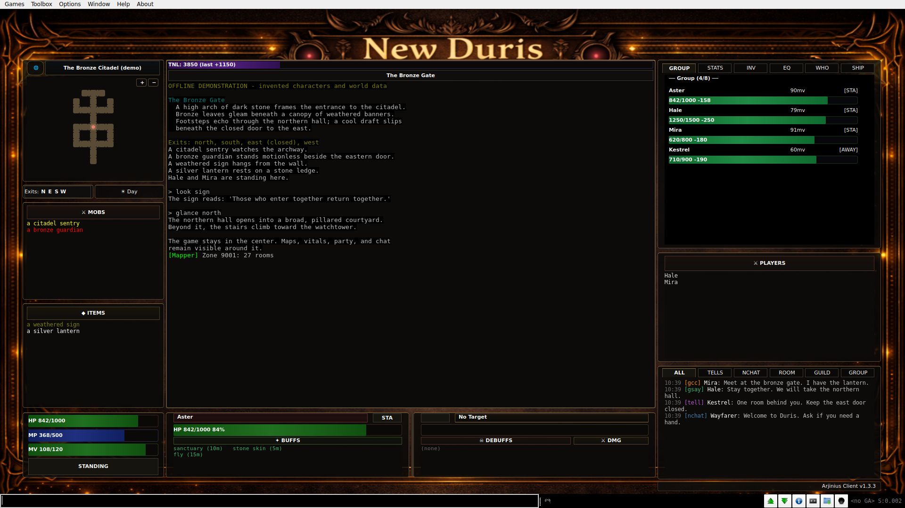

# Mudlet GUI page plan

Prepared 2026-10-15. **Scope: plan, draft page copy, and real client screenshots.**
The website page is not implemented by this document. Its proposed public route
is `/mudlet-gui`, with the navigation label **Mudlet GUI**.

## Purpose and launch dependency

Help a visitor understand the Duris desktop interface, inspect what it actually
shows, and install the **Arjinius Client** package in Mudlet. Keep the existing
`/play` browser client available as the immediate alternative. Reading the page
and downloading the package must not require a website account.

The inspected GUI checkout is version **1.3.3**, commit
`00c3a819b175feacb0d0a2d194dff41b7a72469a`. On 2026-10-15, the
[latest published release](https://github.com/LuminariMUD/duris-client/releases/latest)
resolved to [v1.3.0](https://github.com/LuminariMUD/duris-client/releases/tag/v1.3.0).
The screenshots below show the local 1.3.3 build. **Before launching the page,
align the advertised features, screenshots, and downloadable release.** The GUI
maintainer can publish the appropriate release through that repository's normal
release process, or the page author can recapture and adjust copy for the
existing release. Publishing a GUI release is a separate task.

Use the supplied [GitHub releases page](https://github.com/LuminariMUD/duris-client/releases)
as the main download destination, without a hardcoded "latest version" badge
or a runtime GitHub API dependency. Check its current package again during
launch review.

## Product evidence and copy boundaries

The current client source and README are the authority. Imported LuminariGUI
reference documents in its `docs/` directory describe a different package.

| Page claim | Evidence in the inspected GUI revision | Wording boundary |
|---|---|---|
| Central game console with information around it | [ArjUI.lua](https://github.com/LuminariMUD/duris-client/blob/00c3a819b175feacb0d0a2d194dff41b7a72469a/src/scripts/ArjUI.lua), overview capture | A desktop Mudlet package; the website does not embed this native interface. |
| Zone and wilderness maps, current position, zoom | [ArjMapper.lua](https://github.com/LuminariMUD/duris-client/blob/00c3a819b175feacb0d0a2d194dff41b7a72469a/src/scripts/ArjMapper.lua), overview and wilderness captures | Zone layouts need the Duris map service; wilderness data comes from the game. Do not promise complete coverage, automatic routing, or click-to-walk. |
| HP, mana, movement, experience, room occupants and exits | ArjUI character/room handlers and rendering, overview capture | Requires game data and GMCP. Non-mana classes show MP n/a. |
| Group condition, target, tank, affects, damage | ArjUI group/combat handlers and text triggers, combat capture | Tank information comes from recognized prompts. Do not claim improved win rates or universal prompt compatibility. |
| Channel tabs and separate tell windows | ArjUI chat handlers, chat/equipment capture | Tell history and contacts last for the current session. Do not promise persistent history or structured recipient-specific chat colors. |
| Inventory, equipment, stats, quests, who and ship details | ArjUI information panels, equipment and wilderness captures | Some panels capture game text. Ship contacts are a text list; quest-map rendering is not implemented. STATS currently requests `score`, despite the older README command table saying `stat`. |
| Optional helpers | [ArjAuto.lua](https://github.com/LuminariMUD/duris-client/blob/00c3a819b175feacb0d0a2d194dff41b7a72469a/src/scripts/ArjAuto.lua) | Automated behaviors start off and need explicit enablement. Keep this secondary to the interface; do not sell unattended play. |
| Installation requirements | [Client README](https://github.com/LuminariMUD/duris-client/blob/00c3a819b175feacb0d0a2d194dff41b7a72469a/README.md), [Mudlet installation manual](https://wiki.mudlet.org/w/Manual:Package_Manager) | Declared minimum is Mudlet 4.19.1 with GMCP. These captures validate Linux Mudlet 5.0.1 only. |

Credit the original creator, Arjinius / Arjin, and maintenance by LuminariMUD.
Link to the repository without adding a license claim; its
[license record](https://github.com/LuminariMUD/duris-client/blob/00c3a819b175feacb0d0a2d194dff41b7a72469a/LICENSE.md)
does not declare a project license.

## Page composition and draft copy

Follow the [Design guide](../DESIGN.md), particularly
[shared components](../DESIGN.md#shared-components),
[layout](../DESIGN.md#layout-and-responsive-behavior), and
[screenshots](../DESIGN.md#preparing-images-and-screenshots).

Reading order: introduction and download → full interface → benefits and
additional screenshots → installation → practical questions → final download
and support links. Use the normal application shell and content gutter, a
centered wide content area, short reading lines for prose, and section rules.

### 1. Introduction

| Element | Draft text |
|---|---|
| Eyebrow | Desktop play · Arjinius Client |
| H1 | Mudlet GUI |
| Display tagline | Keep the world in view. |
| Introduction | Explore Duris with your map, group, and conversations beside the action. Arjinius Client gives Mudlet a dedicated Duris interface, keeping the game text at the center and the details you need within reach. |
| Primary action | Download GUI package |
| Supporting action | Get Mudlet |
| Browser alternative | Prefer to start here? Play in your browser. |
| Requirement line | For desktop Mudlet 4.19.1 or newer. Requires a Duris profile with GMCP enabled. |

The primary action opens the GitHub releases page. Beside the link, say
**Choose `duris-client.mpackage` from the release assets.** The package requires
Mudlet to be installed separately. Use `IndexLabel`,
`DisplayHeading`, and `SectionRule`. Use the local Cormorant Garamond face at
weight 400 for display text. Keep all headings and controls as HTML.

Use the website's ink surfaces, bone text, and vermilion accents. Preserve the
client's bronze artwork and colors inside the screenshots. Place the overview
capture below the introduction at the full content width, without decorative
overlays or cropping away its controls.

### 2. Benefits

Use these six short benefits, with generous spacing and fine rules. A two-column
text layout can collapse to one column on narrow screens. Keep the screenshots
large and separate from tiny feature cards.

| Heading | Draft body |
|---|---|
| Your adventure stays central | Read the room, follow the fight, and enter your next command in the central console. Character details, maps, and conversations have their own space around it. |
| Find your bearings | Follow your position through available zone layouts, then switch to the wilderness view outside. Zoom controls and visible exits help you understand the room around you. |
| Keep an eye on the group | See group health and movement, spot a hurt companion, and notice who is away from your room. Target, tank, and affect displays keep combat details nearby. |
| Give each conversation its place | Follow guild and group chat in dedicated tabs, keep public channels together, or open a separate window for a tell. Timestamps help you follow the exchange. |
| Bring the details within reach | Check equipment, inventory, character information, and quest progress without losing the main game view. Dedicated tabs also provide who-list and ship-contact information. |
| Choose your own helpers | Use numpad movement and utility commands, then enable individual automation helpers if you want them. Automatic behaviors start off; `ui help` and `auto` explain the available controls. |

Follow the combat benefit with its screenshot, and the conversation benefit
with the equipment/tell screenshot. Use the wilderness capture to demonstrate
the alternate map and character/quest panel. Do not attach an unsupported
feature claim to a screenshot merely because its tab is visible.

### 3. Installation

Section heading: **Set up your next session.**

1. **Install Mudlet.** Get the desktop application from the official Mudlet
   download page. The package requires Mudlet 4.19.1 or newer.
2. **Open your Duris profile.** Enable GMCP in the profile and in the game.
   If connection details are displayed, use the existing public site
   configuration rather than copying a host or port into this page.
3. **Install the GUI package.** Open the
   [GitHub releases page](https://github.com/LuminariMUD/duris-client/releases)
   and download `duris-client.mpackage` from the current release's assets. In Mudlet,
   open Package Manager, choose **Install New Package**, and select the file.
   The package appears as **Arjinius Client**. `Alt+O` is the shortcut documented
   by the client; also link the official Package Manager instructions.
4. **Reconnect and enter the world.** Fresh character and room data populate
   the panels. Type `ui help` to explore the controls.

Supporting copy: **Already installed?** Download the current package from the
release page, replace the installed copy through Package Manager, and reconnect.
Read the release notes for changes.

Do not advertise an installation time, automatic update mechanism, or an
installer for each OS. The official [Mudlet download page](https://www.mudlet.org/download/)
provides Windows, macOS, and Linux downloads; this work does not establish
cross-platform compatibility of the GUI package.

### 4. Practical questions

Use ordinary headings and paragraphs rather than adding an accordion solely
for a few short answers.

**Is this the browser client?** This is a package for the desktop Mudlet
application. You can also [play in your browser](/play) from this website.

**Why are some panels empty?** Enter the game with GMCP enabled, then try
`ui debug` if character or room information is missing. Reconnecting requests
fresh data. Some information, including equipment and tank condition, depends
on recognized game text and prompt formats.

**What if the map is missing?** Zone maps need access to the Duris website's
map service. Try `mapper status`, then `mapper reload` followed by `look`.
Wilderness maps use information supplied by the game.

**Does it play for me?** The interface organizes game information around your
commands. Optional automation helpers are individually enabled and start off.
Type `auto` to review them before changing settings.

**Can I return to the standard console?** Use `ui off` to restore Mudlet's main
console and command line. Use `ui on` to build the interface again.

**Where can I get help?** Read the client guide and release notes, or report a
problem in the client repository's issue tracker.

### 5. Closing action and attribution

Heading: **Make room for the whole adventure.**

Body: **Bring maps, conversations, and character details into your next Duris
session. Install the GUI package in Mudlet and enter the world.**

Repeat **Download GUI package**, with secondary links to release notes, the
client guide, and the issue tracker. Add: **Originally created by Arjinius /
Arjin. Maintained by LuminariMUD.**

### Link destinations

| Label | Destination |
|---|---|
| Download GUI package | [GitHub releases page](https://github.com/LuminariMUD/duris-client/releases) |
| Get Mudlet | [Official downloads](https://www.mudlet.org/download/) |
| Release notes | [Latest release](https://github.com/LuminariMUD/duris-client/releases/latest) |
| Client guide | [Repository README](https://github.com/LuminariMUD/duris-client#install) |
| Package Manager instructions | [Mudlet manual](https://wiki.mudlet.org/w/Manual:Package_Manager) |
| Report a problem | [Client issues](https://github.com/LuminariMUD/duris-client/issues) |
| Play in your browser | Internal route `/play` |

Use native anchors for external URLs. An existing `Button` with `as-child` and
`variant="brand"` can style the download anchor. `BrandActionLink` and
`BrandTextLink` are internal router links; use them for `/play`. If a link opens
a new tab, explain that behavior and use `rel="noopener noreferrer"`.

## Screenshot set

These are native Mudlet window captures, **not website mockups or live player
sessions**. All characters, dialogue, combat, equipment, and geography are
invented. Keep this visible in a gallery caption, along with the captured
client version. Capture provenance, hashes, reproduction commands, and review
results live in the [asset README](assets/mudlet-gui/README.md).

| Asset | Suggested caption and alt text |
|---|---|
| [overview.png](assets/mudlet-gui/overview.png) | Caption: "The game at the center, with maps, room details, group status, and chat around it." Alt: "Arjinius Client showing a central game console, a zone map and room lists on the left, group and chat panels on the right, and vitals along the bottom." |
| [combat-group.png](assets/mudlet-gui/combat-group.png) | Caption: "Group condition, tank and target information, affects, and damage during an illustrative fight." Alt: "A demonstration fight with Hale highlighted in the group, a bronze guardian at 40 percent health, poison in the debuff panel, and a damage total of 148." |
| [chat-equipment.png](assets/mudlet-gui/chat-equipment.png) | Caption: "Equipment, guild chat, and a separate tell window stay near the main console." Alt: "The equipment tab lists five items while guild chat and a private conversation with the fictional character Kestrel appear beside the game console." |
| [wilderness.png](assets/mudlet-gui/wilderness.png) | Caption: "The wilderness map replaces the zone layout; STATS shows character and quest details." Alt: "A colored wilderness map with a position marker on the left and character stats with a two-of-five guardian quest on the right." |



All four originals are 1920 × 1080 PNGs. On the eventual page:

- Preserve aspect ratio, specify width and height, and provide a named link
  such as **Open overview screenshot at full size**. Avoid a new carousel or
  lightbox dependency. A full-size link lets readers inspect dense native UI.
- On mobile, stack the surrounding copy and images. Do not imply that the
  native desktop interface itself becomes a mobile GUI. Keep explanatory copy
  readable without requiring the image's tiny text to convey the main benefit.
- Import page assets through Vite from `frontend/src/assets/mudlet-gui/` when
  implementing. Retain these originals and provenance. Any smaller delivery
  derivatives need a visual text-legibility check and full-size original link.
- Eager-load only the initial overview if it is important in the first
  viewport; lazy-load later images. Do not recolor the captured client to match
  the website or replace its existing "New Duris" artwork.

## Implementation tasks

These tasks are for the subsequent page implementation. The completed planning
deliverables are the copy, screenshot set, fixture, and provenance in this change.

1. **Resolve the download/screenshot version dependency.** Verify the release
   asset and package metadata. Recapture or revise feature wording if the
   selected public package differs from the inspected 1.3.3 source.
2. **Add a public, lazy route and view.** Create
   `frontend/src/views/MudletGuiView.vue`; register `/mudlet-gui` with name
   `mudlet-gui` in [router/index.ts](../../frontend/src/router/index.ts).
   Use the default gutter, ordinary shell scrolling, and no auth, fullscreen,
   or hide-navigation metadata.
3. **Build the content with shared design components.** Keep the content in
   the view unless a repeated structure warrants a small typed array. Use
   semantic palette tokens, the supplied copy, native links, and accessible
   figures. No backend endpoint, database change, package mirror, new fonts,
   animation framework, or download tracking is needed.
4. **Centralize repeated destinations.** Extend
   [config/links.ts](../../frontend/src/config/links.ts) for the release/download,
   client guide/support, and Mudlet destinations used by the page. Keep the
   external package download on GitHub. Do not fetch GitHub release metadata
   on every page visit.
5. **Make the page discoverable.** Add **Mudlet GUI** to the desktop Browse menu
   in [App.vue](../../frontend/src/App.vue), including its active-route check.
   Add it beside Guide in the mobile More menu in
   [BottomNavbar.vue](../../frontend/src/components/layout/BottomNavbar.vue).
   Keep the existing primary Play destination at `/play`.
6. **Set page metadata.** Use the existing `useHead` pattern. Title:
   `Mudlet GUI | <configured site title>`, with the existing unavailable-state
   behavior when configuration is missing. Description: "Explore the Duris
   Mudlet GUI: maps, group status, organized chat, and character details around
   your game console. See screenshots and install the client package."
   Use site configuration for displayed branding and connection details.
7. **Verify, then prepare release artifacts.** Complete the checks below in an
   isolated development checkout. A documentation commit does not publish
   this proposed route. Follow the website deployment process when the page
   implementation is approved for release.

## Acceptance and verification for the eventual page

- [ ] A logged-out visitor can open `/mudlet-gui` directly and through both
  navigation menus. Play still opens `/play`.
- [ ] The download action opens the supplied GitHub releases page, where the
  intended `.mpackage` is available. Its version matches the screenshots and
  advertised behavior. Readme, support, and Mudlet links work.
- [ ] The page follows the eclipse tokens, serif heading weight 400, rectangular
  controls, ordinary shell gutter, and existing focus treatments.
- [ ] At 390, 768, and 1440 CSS pixels wide, and at 200% browser zoom, content
  fits without horizontal page scrolling or fixed navigation covering controls.
- [ ] Keyboard users can reach the download, installation links, full-size
  screenshots, and browser alternative. Link names describe their destinations;
  decorative icons are hidden from assistive technology.
- [ ] Every screenshot has useful alt text, a visible demonstration-data caption,
  reserved dimensions, and a readable full-size destination. Information is
  available in text as well as through colored native panels.
- [ ] Missing site configuration does not invent a MUD address, port, or title.
  The route preserves the shell's existing availability behavior.
- [ ] Add focused `MudletGuiView.spec.ts` coverage for the public content,
  download destinations, image descriptions, and configuration behavior.
  Extend the existing
  [BottomNavbar tests](../../frontend/src/components/layout/__tests__/BottomNavbar.spec.ts)
  to verify the new internal destination. Verify desktop Browse navigation in
  the rendered app, including its active state.
- [ ] Run the following from the repository root, with the build in a disposable
  checkout because this host's main `frontend/dist` is served live:

```bash
pnpm --dir frontend test:unit --run src/views/__tests__/MudletGuiView.spec.ts src/components/layout/__tests__/BottomNavbar.spec.ts
pnpm --dir frontend format:check
pnpm --dir frontend lint
pnpm --dir frontend type-check
./frontend/scripts/check-palette-literals.sh
pnpm --dir frontend build
```

The current planning change does not modify either application package. Its
actual checks are recorded in the [asset README](assets/mudlet-gui/README.md);
the frontend commands above remain future implementation acceptance criteria.
