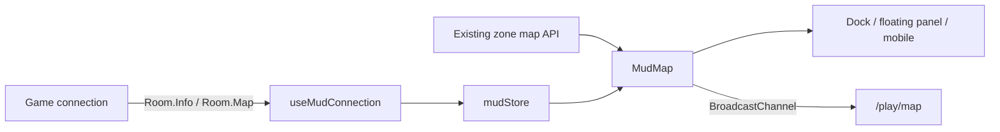

# Adapting the Mudlet mapper to `/play`

Investigation date: 30 October 2026. Investigation only; no game-client changes,
MUD changes, deployment, or live gameplay qualification.

Implementation follow-up: the investigation below records the original findings.
The local adaptation is now implemented; the owning behavior contract is
[Browser game maps](../DESIGN.md#browser-game-maps). No production deployment
is included in this work. The release entry below remains unpublished until
deployment acceptance.

### Local implementation validation

The implementation keeps one session controller, the existing backend endpoint,
the Cytoscape overview and a bounded SVG local view. No dependency, migration,
backend change or MUD change was needed. Old per-renderer downloads, movement
loops and the global pop-out channel were replaced. Dock/floating/mobile maps
share preferences; the standalone receiver owns no game connection.

The checks passed (including the review corrections):

```bash
pnpm --dir frontend format:check
pnpm --dir frontend lint
pnpm --dir frontend type-check
./frontend/scripts/check-palette-literals.sh
pnpm --dir frontend test:unit --run
# 86 suites, 657 tests passed.
pnpm --dir frontend test:unit --run src/composables/__tests__/usePlayMap.spec.ts src/composables/__tests__/useMapBroadcast.spec.ts src/utils/__tests__/playMap.spec.ts src/utils/__tests__/mapNavigation.spec.ts
# 4 focused suites, 22 tests passed after review corrections.
pnpm --dir frontend build
pnpm --dir frontend build-only
git diff --check
```

The builds used explicit local public frontend configuration (loopback API/static
URLs, a loopback WebSocket URL, and loopback Vite hosts/ports), not production
environment files. `build` includes the type check; the final `build-only`
qualified the last container-sizing change. Build output is ignored and was
not published. The existing large-chunk warnings for editor/icon bundles remain.
Targeted Biome formatting was applied only to changed frontend files.

Additional focused commands run while implementing:

```bash
pnpm --dir frontend test:unit --run src/utils/__tests__/playMap.spec.ts src/utils/__tests__/mapNavigation.spec.ts src/composables/__tests__/useMudConnectionCredentials.spec.ts src/composables/__tests__/useMudConnectionChargen.spec.ts src/components/mud/__tests__/MudCommandInput.spec.ts
pnpm --dir frontend test:unit --run src/components/mud/__tests__/MudCommandInput.spec.ts
pnpm --dir frontend test:unit --run src/composables/__tests__/useMudConnectionChargen.spec.ts
pnpm --dir frontend test:unit --run src/composables/__tests__/usePlayMap.spec.ts src/utils/__tests__/mapNavigation.spec.ts
pnpm --dir frontend test:unit --run src/composables/__tests__/useMapBroadcast.spec.ts
pnpm --dir frontend exec playwright --version
python3 "$EVIDENCE_DIR/play-map-qa.py"
python3 "$EVIDENCE_DIR/play-map-review-qa.py"
python3 .agents/skills/news-update/scripts/sync_client_changelog.py
```

Initial type-check errors in the new Cytoscape arrow typing and MapText props,
and an initial pager-test failure from quest-cache cleanup, were repaired.
Quest caches now retain reconnect behavior while separating characters. A shell
log wrapper failed after successful test/build output; both commands were rerun
directly and returned zero. The first browser launch expected an unavailable
Playwright browser version; qualification used an already installed Chromium
binary instead, without installing dependencies.

Browser plugin: unavailable. Regular Python Playwright 1.58.0 with Chromium
153.0.8010.12 exercised the actual `/play` route on a local Vite server at
1440×1000 and 390×844, plus the real `/play/map` popup. APIs and game packets were
synthetic fixtures; no live game socket or real login was used. The flow was
login → character entry → map inspection → acknowledged walk → level change →
minimize/restore → float/resize/dock → overview/all levels → pop-out → wilderness
zoom → session expiry → mobile Map tab. Direct inspection keys sent no command;
one walk sent exactly one east command before its destination was acknowledged.

The same browser run checked large maps at both widths, contradictory levels,
a missing current room, invalid map data, a deliberate HTTP 401, and long-name
tooltip bounds. It verified an actual nonzero overview canvas, all twelve
fixture nodes in All levels, visible-set replacement across floors, and fresh
open-door coloring overriding an older closed reverse-door observation.
Screenshots were inspected. Visual checks found and repaired a clipped short-panel
inspector, incorrect marker tokens and a Cytoscape container that collapsed to
zero height after mounting; canvas existence alone did not prove those behaviors.
No framework/runtime errors were observed. Console output retained the existing
router `next()` deprecation and the expected deliberate 401 resource error.

On the synthetic 2,000-room / 3,910-exit grid, observed layout runs were about
3–8 ms and two-frame room-update measurements about 16–34 ms, rendering 42 local
room tiles. These are local Chromium fixture measurements, not production or
cross-device performance guarantees. Screenshots and the browser script remain
outside Git in the session evidence directory.

The pre-PR review corrected paused-window authorization checks, keyboard
inspection with click-to-walk enabled, generated rooms overlapping partial saved
positions, door-state normalization across legacy/abbreviated keys and empty
names, overflowing saved coordinates, and vertical self-loop ambiguity. The
expanded browser journey verified the paused HTTP-401 refusal and recovery,
keyboard inspection without movement, exact saved-room coordinates, and fallback
separation. It also exposed an inspector covering Resume in a short dock;
the inspector now scrolls within the map's available height. The review journey
passed after those fixes. The existing Mudlet news snapshot was checked against
upstream and already covered all 24 versions through 2.4.1 at the pinned commit.

Backend gates, database/MUD-write verification, migrations, real-Mudlet tests,
live authenticated gameplay, Firefox/Safari and physical touch/DPI testing were
not run. There was no backend/MUD runtime change or deployment. The unpublished
news draft is intentional for this implementation-only scope; publication still
requires the normal authorized deployment and acceptance. The pre-existing
untracked investigation document was preserved and extended; no unrelated dirty
work was present at implementation start. A final status check found concurrent
documentation edits in the sibling durisclient checkout; they were left untouched.

### Prepared website changelog

- Title: Explore Duris with a clearer live map
- Category: public
- Version: use the verified release date; provisional `2026.10.30`
- Publication: local draft only; publish after the described release is live.

```html
<h3>Play</h3>
<ul>
  <li><strong>A new Local map.</strong> Follow your position through connected rooms and passages, with stairs, terrain, doors and room details. Switch to Overview for the wider area and inferred levels.</li>
  <li><strong>Inspect before moving.</strong> Select a room to inspect it, then choose Walk here. Enable Click rooms to walk for direct movement. Walking waits for each destination and stops on an unconfirmed move, combat, a manual command or disconnection.</li>
  <li><strong>Maps that stay with your session.</strong> Zoom and preferences survive movement, floating and restoring. Pop-out maps follow their own game window and expire when that session ends. Wilderness and quest maps preserve their terrain colors and text spacing.</li>
  <li><strong>Clear recovery controls.</strong> Pause and Resume control map updates; Reload refreshes unavailable or changed maps. World map and Zone wiki links remain nearby.</li>
</ul>
```

## Assessment

**High feasibility for the full custom ArjMapper experience.** Both clients
already consume the same zone graph API and the same `Room.Info` / `Room.Map`
facts. The substantial work is a browser renderer and reliable map-state
handling. A protocol change, new database, world-map extraction, or Lua runtime
in the browser is not required for parity with the inspected mapper.

The recommended result is a compact, player-centered local view based on
Mudlet, with the website's existing zone overview, speedwalking, visited-room
information, quest maps, mobile sheet, floating panel, and pop-out retained.
Port the behavior and data algorithms into TypeScript/Vue; Geyser widgets,
Mudlet timers, download handlers, and aliases need browser equivalents.

Confidence is high in the integration fit and medium in the unbuilt visual
result and effort estimate. Source review and offline probes establish the
findings below; they do not establish production gameplay, mobile appearance,
or authoritative geographic floors.

## Inspected versions and scope

- DurisWeb local HEAD: `ec93875ebbfe2eba4cd508fa90753d2777cf3fe6`
  (`Resolve zone maps from active AREA membership (#137)`).
- durisclient local HEAD: `09924db4f2c9a5ffe47c44ebbed7977cc432eecb`
  (`Merge pull request #24 from LuminariMUD/branch/fix-time-command-gag`),
  package version 2.4.1.
- Both worktrees were clean when inspected. No upstream fetch was performed;
  these identify the inspected checkouts, not an assertion about remote HEAD.
- The donor is the custom 1,461-line
  [ArjMapper.lua](https://github.com/LuminariMUD/duris-client/blob/09924db4f2c9a5ffe47c44ebbed7977cc432eecb/src/scripts/ArjMapper.lua), plus its
  map header/lifecycle integration in
  [ArjUI.lua](https://github.com/LuminariMUD/duris-client/blob/09924db4f2c9a5ffe47c44ebbed7977cc432eecb/src/scripts/ArjUI.lua). It is not Mudlet's
  native persistent mapper database or a downloadable world-map archive.
- The target is the 1,508-line
  [MudMap.vue](../../frontend/src/components/mud/MudMap.vue), its connection
  adapter and store, and the existing dock/mobile/pop-out integration.
- `/wiki/map`, `/surface-map`, and ship radar are adjacent features, not donor
  features that need to be recreated. The inspected Mudlet mapper opens the
  website's world map through a link.

The separate MUD repository was neither modified nor operated. Protocol
evidence came from the clients and the donor's checked-in, server-generated
[GMCP fixtures and provenance](https://github.com/LuminariMUD/duris-client/blob/09924db4f2c9a5ffe47c44ebbed7977cc432eecb/tests/mudlet/fixtures/README.md).
The root `.env` is absent in this checkout; no application, database, Redis,
or MUD service was started.

## Why the integration is a good fit

The existing path is already:



The shared endpoint is `GET /api/wiki/zones/{zoneNumber}/map-data`.
[getZoneMapData](../../backend/src/services/wikiService.ts#L746) selects the
active area once, reads its rooms and optional saved positions, and returns
`nodes: {id, name, sectorType, x?, y?}[]` plus directed
`edges: {from, to, direction}[]`. It filters secret exits. The current active
AREA selection should be reused without introducing a second numeric-zone
resolver.

Mudlet reads wire fields such as `num`, `zone`, `coords`, abbreviated exits,
and a separate `doors` object. The web
[connection adapter](../../frontend/src/composables/useMudConnection.ts#L656)
already transforms these into `MudRoom`, long direction names, and structured
door state. Reuse that boundary rather than adding another GMCP subscription
inside a renderer. Strengthen its validation for wilderness exits, which can
be booleans rather than destination VNUMs.

A bounded read-only production check of the
[same zone endpoint](https://duris.sbs/api/wiki/zones/344/map-data) returned
HTTP 200: 89 nodes, 196 directed edges, all ten direction names, and **zero
nodes with saved x/y coordinates**. This demonstrates the API's practical fit
and the need for automatic layout. It does not identify the deployed commit,
MUD world revision, or running client behavior. The isolated backend fixture
contains different world data and should not be compared by room count to
infer a production defect.

## Feature coverage and adaptation

1. **Zone maps and API loading: reuse.** Both clients fetch the endpoint above.
   Mudlet caches multiple zones in memory, validates the response shape,
   coalesces a request per zone, and gives requests a 15-second timeout. The
   website currently remembers one loaded zone per component. Share a small,
   bounded in-memory cache and pending-request map across web map views;
   clear them on account/access changes and explicit reload. Do not persist
   privileged map data or bypass wiki authorization with stale cache entries.

2. **Local dungeon appearance: browser work.** Mudlet renders bronze room
   tiles and continuous passages, a coral player marker, diagonal connectors,
   closed-door colors, and up/down triangles. It centers the player and limits
   rendering to the inferred current level within a five-cell radius, further
   clipped to the panel. A Vue/SVG local surface can reproduce this without
   adding a graphics dependency. The ordinary maximum is an 11-by-11 grid of
   visible room cells before panel clipping; graph calculation still processes
   the whole zone. Exact Qt font rasterization is not a useful acceptance gate.

3. **Layout: port selectively.** Mudlet builds a direction-aware 3D grid from
   edges, starts with high-degree rooms, prioritizes reciprocal links, searches
   for unoccupied cells, gives loop-closing candidates a preference, and places
   disconnected sections beside one another. This is useful for a stable local
   view. Add deterministic tie-breaking and avoid mutating API objects. Preserve
   saved 2D positions in the overview; the donor ignores them. Keep inferred
   levels separate from saved x/y coordinates.

4. **Floors: achievable as inferred levels.** The API has no per-room z or
   authoritative floor field. Mudlet derives `gz` from up/down edges; storing
   `coords` does not make those coordinates its layout authority. Conflicting
   loops, non-geometric exits, and independently rooted components can make
   inference ambiguous. Expose an overview fallback and identify levels as
   inferred. Guaranteed geographic floors would require a separate data
   contract investigation; neither current client proves them.

5. **Wilderness and ship-area ASCII maps: reuse transport, adapt parsing.**
   Both render server-authored `Room.Map` text. Preserve glyphs and whitespace,
   use a monospace font, reset attributes on each row/map, and provide independent
   text zoom. Detect wilderness from the raw room contract as well as known zone
   ranges; a numeric-zone-only test misses special rooms and boolean exits.
   Define how `Room.Info` / `Room.Map` order selects the active presentation.

6. **Doors: retain the richer web model.** Mudlet's renderer effectively marks
   closed doors in the current room, with compatibility for `#` exit names.
   The web client already retains door names, open/closed/locked state, and
   historical visited-room facts. Keep those distinctions, clearly treating
   old observations as last-known state. Do not downgrade to one boolean.

7. **Tooltips and controls: reuse web patterns.** Both show a room identifier
   and name and have zoom controls. Mudlet also has enable/pause, status/debug,
   cache reload, room-size commands, and world/current-zone links through its
   header. Supply equivalent controls or local command handlers in `/play`,
   keeping them out of commands sent to the MUD. Clamp tooltips to the panel
   and make room inspection available to keyboard and touch users.

8. **Existing web navigation: preserve separately from drawing.** The donor
   has no click-to-speedwalk. `/play` already has directed BFS routes, door
   opening, locked-door avoidance, a stop action, and combat cancellation.
   Keep the existing overview and route intent when introducing a local view.
   The renderer should request navigation; it should not own a movement loop.
   Inspection must also be possible without starting movement.

9. **Floating, mobile, and pop-out: reuse their shells.**
   [MudGameClient](../../frontend/src/components/mud/MudGameClient.vue#L587),
   [FloatingMapWindow](../../frontend/src/components/mud/FloatingMapWindow.vue),
   [PopOutMapView](../../frontend/src/views/PopOutMapView.vue), and
   [useMapBroadcast](../../frontend/src/composables/useMapBroadcast.ts) already
   supply these surfaces. Keep data loading and command ownership independent
   of which presentation is mounted. Observe size/visibility changes and cancel
   observers, retries, and downloads on teardown.

10. **Quest and world maps: preserve existing web features.** Mudlet explicitly
    does not render `Quest.Map`; the website already has
    [QuestPopover](../../frontend/src/components/mud/QuestPopover.vue).
    Keep that capability. World-map links can continue to open `/wiki/map`;
    no replacement world renderer or access to restricted realtime positions
    is needed for ArjMapper parity.

Some donor names overstate what is rendered: `getSectionColor`, `doorOpen`,
and the opposite-direction table are defined but unused. Visible rooms use a
common floor color; far links use a darker passage color, not a full
section-colored portal system. Full parity should follow observable behavior,
not these unused declarations.

The newer website
[wikiZoneMapLayout helper](../../frontend/src/utils/wikiZoneMapLayout.ts) is
also useful: it is deterministic, packs weakly connected components, and
retains every directed exit in combined visual links. Its layout is 2D and
explicitly schematic. Reuse its direction/connection conventions and tests
where appropriate; it cannot supply Mudlet-style levels unchanged. The builder
`useZoneMap` composable is a different editing concern.

## Gaps demonstrated in the current web map

These are investigation findings, not fixes delivered by this document.

### Offline behavior probes

- **Late response replaces a newer zone.** Starting downloads for A=10 and
  B=11, completing B first, then A, leaves `loadedZoneNumber` at 10. The
  [fetch function](../../frontend/src/components/mud/MudMap.vue#L502) has no
  request generation/session check, abort, timeout, or runtime schema parser.
  Guard acceptance, not only request initiation. A late failure can also clear
  newer data. Do not let an old request's `finally` clear a newer loading state.
- **Same-zone floor changes leave the old visible graph.** The element builder
  would show rooms 1,2 before an up exit and 3,4 afterward, but the real Vue room
  watcher only updates styles and camera. It never replaces graph elements.
  Rebuild the visible set when inferred level/component changes.
- **Map color parsing differs.** With `&=bY^` followed by LF, the existing HTML
  parser keeps the blue background around the next row. `&]` and legacy literal
  `\n` remain text; lowercase black maps to gray. The actual Lua map parser
  handles all four differently. A foreground-only `&+g` already starts a fresh
  span and correctly clears the preceding background; do not report that
  existing transition as broken. Add a map-specific parser instead of changing
  the globally pinned console/editor palette as a side effect.

### Additional source-confirmed integration gaps

- **Zoom resets on movement.**
  [centerOnCurrentRoom](../../frontend/src/components/mud/MudMap.vue#L1028)
  animates to `zoom: 1` on every room change. Following the player should retain
  the chosen scale.
- **Pop-out wilderness zoom targets the graph.** The standalone branch binds
  its controls to graph handlers and omits the ASCII controls found in the
  normal branch. It leaves wilderness text scale unchanged.
- **Directed information is lost in drawing.** `buildElements` deduplicates
  room pairs and keeps only the first direction; generic edges have no ordinary
  travel arrows. Keep every directed exit even if the visual combines a pair.
  Never use the combined visual edge as route authority.
- **Session reset leaves map text behind.**
  [mudStore.reset](../../frontend/src/stores/mudStore.ts#L687) clears room and
  visited state, but does not clear `wildernessMap`; the component's null-zone
  watcher also leaves accepted graph state alone. Explicitly retire map data
  and pending work when a session ends.
- **Mode tests diverge.** `MudMap` includes zone 600 in wilderness exclusions;
  the connection adapter's clearing rule does not. The adapter asserts numeric
  exits even though the donor's wilderness fixtures use booleans. Normalize
  once and preserve an explicit room/map kind.
- **Pop-out ownership is global.** Every sender uses `duris-map-sync`, without
  a game-session identifier. The receiver marks itself connected once and has
  no expiry path. Scope synchronization and navigation requests to the owning
  play session, validate messages, and expire stale state. Do not add a second
  game socket in the pop-out.
- **Speedwalking is time-based.** The current loop waits fixed delays rather
  than acknowledging the expected destination through `Room.Info`. It can
  announce completion after a blocked route. Before extending click movement
  to the new surface, require room acknowledgement, failure/timeout handling,
  and one command owner across mounted views. This is preservation and
  hardening of a web capability, not code available from ArjMapper.
- **Visibility is not observed.** The graph retries zero-size initialization
  with an untracked timeout and does not use `ResizeObserver`. Minimize/restore,
  floating resize, and desktop/mobile visibility need explicit coverage.

## Recommended implementation boundary

Keep `MudMap.vue` as the panel/controller boundary and initially retain its
Cytoscape overview. Add a small Vue/SVG local view for the distinctive room and
passage rendering. Both views should consume one validated graph and the same
live overlay. SVG suits the bounded local room set and gives normal DOM hit
targets and focus behavior; this is an engineering recommendation, not a
measured comparison against a completed Cytoscape implementation.

Use only the modules required by that separation:

- A typed map-data loader: shared pending requests, bounded memory cache,
  response validation, explicit reload/error states, timeout and stale-session
  refusal. Stay with same-origin requests and cookie-based website auth.
- Pure layout/connection helpers: normalized directions, stable placement,
  collision resolution, inferred levels/components, directed exits and far-link
  markers. Keep topology independent of pixel positions.
- A map-only text parser returning escaped tokens/runs for wilderness and,
  if adopted there, quest maps. Preserve the current console/editor contract.
- A local renderer plus existing overview/wilderness surfaces; panel controls,
  tooltip/selection, and navigation intents remain shared.

Reuse the existing Pinia store and connection rather than inventing a general
map framework, worker platform, new server service, or extra dependency.
Compute layout once per accepted graph revision and update the player/door
overlay on room messages. Use adjacency indexes instead of repeated full-array
searches in hot paths. Skip hidden rendering and coalesce rapid redraws, while
retaining the final accepted update. Consider a worker only after measuring a
problem on representative large zones.

The API's optional-auth wiki gate and secret-exit filtering remain authoritative.
Being logged into the MUD does not automatically establish a website session;
when wiki access is registered-only, present a login/unavailable state. Preserve
the existing restricted realtime-map permissions. New caches must not turn
revoked access into continued display.

## Suggested delivery and effort

These are rough engineering estimates for someone familiar with this repository,
not a delivery commitment or benchmark of agent execution speed.

1. **Data/state foundation, about 1–2 engineering days.** Normalize wilderness
   and room facts, add loading/validation/session ownership, reproduce the race
   and transition findings with proper component tests, and add the dedicated
   map-color contract. Existing appearance can remain through this step.
2. **Local layout and presentation, about 2–3 days.** Port the useful layout
   behavior, add stable tie-breaking/inferred-level handling, room/passages,
   marker, stairs, doors, far exits, tooltips, zoom, pause/reload, and links.
   Retain the zone overview and visited/terrain information.
3. **Web integration and qualification, about 2–4 days.** Finish dock/floating/
   mobile/pop-out resize and session behavior, keyboard/touch inspection,
   cache/error/access transitions, and representative browser qualification.
4. **Movement hardening, about 2–3 additional days if included.** Extract one
   navigation owner, require destination acknowledgement, and qualify stop,
   combat, locked doors, failed movement, disconnect and pop-out requests.

Thus approximately **5–9 engineering days for tested map parity and existing
web-surface integration**, or **7–12 with movement hardening**. Difficult zone
topology or newly requested authoritative floors could expand the work.
The first implementation should remain frontend-scoped; backend/MUD changes
need a demonstrated missing data contract, not a presumption that mapping
requires a server rewrite.

## Acceptance criteria for an eventual port

- Zone → wilderness → zone, rapid A → B → A, delayed success/failure, missing
  map, invalid data, access refusal and explicit reload never display an old
  graph as the current zone.
- N/E/S/W, all diagonals, U/D, one-way exits, multiple exits between a room
  pair, loops, collisions, disconnected sections, external destinations and
  a current room absent from the API have defined behavior. Ambiguous inferred
  levels remain navigable through overview.
- Movement keeps the selected zoom, follows the correct player marker, and
  refreshes the visible level. Current doors replace last-known observations.
  Secret edges do not appear through a renderer/cache change.
- Wilderness preserves space cells and glyph alignment; `&=XY`, `&+X`, `&-X`,
  resets including `&]`, LF/CRLF/legacy newlines and black match the map contract.
  Repeated updates cannot bleed attributes into later rows or other UI.
- Dock, floating resize/maximize, minimize/restore, hidden panels, mobile tabs
  and pop-out all use the same accepted session. Closing/logging out expires
  the pop-out; two play tabs do not exchange locations or navigation requests.
- Pointer, keyboard, and touch can inspect a room without unintended movement.
  Tooltips stay inside narrow panels and controls have visible labels/focus.
- Existing quest maps and world links still work. Any movement integration has
  one owner and stops on mismatch, timeout, combat, manual stop or disconnect.
- Validate representative small, large, stacked, disconnected and contradictory
  zones at narrow mobile and desktop sizes. Measure large-zone layout and room
  update costs; do not infer performance from line counts or the small probes.

## Verification performed

The following package commands passed on unchanged application source:

```bash
pnpm --dir frontend test:unit --run src/utils/__tests__/ansiParser.spec.ts src/utils/__tests__/wikiZoneMapLayout.spec.ts
# 2 suites, 15 tests passed.

pnpm --dir backend test --runInBand src/services/__tests__/wikiZoneMapData.test.ts
# 1 suite, 23 tests passed; isolated fixture filesystem, mocked database/cache.
```

Two authored probe files were kept outside Git in this chat's evidence directory.
They were run using the following commands, where `EVIDENCE_DIR` is the local
directory containing `map-port-probes.mjs` and `map-port-lua-probes.lua`:

```bash
node "$EVIDENCE_DIR/map-port-probes.mjs"
lua "$EVIDENCE_DIR/map-port-lua-probes.lua"
```

The Node probe transpiles the checked-out `MudMap.vue` setup script, removes
imports, supplies real Vue reactivity/watchers, and replaces network/renderer
surfaces with fakes. It reproduces the response race and missing floor rebuild,
checks the ASCII scale handler, and evaluates the real ANSI parser with jsdom.
It forbids game-command sends. It does not mount or visually render the map.

The Lua probe loads the production mapper definitions with only the final
startup call removed, without Geyser, network or Mudlet events. It checks
compass/up/diagonal placement, unique cells and a disconnected component,
wilderness detection, and LF/reset/legacy-newline/black parsing. It passed.
It is not a rerun of the real-Mudlet UI suite.

The successful live read command was:

```bash
curl -A DurisWeb-map-investigation/1.0 --max-time 15 -sS \
  -o /tmp/duris-map-investigation-live.json -w '%{http_code}' \
  https://duris.sbs/api/wiki/zones/344/map-data
```

Python inspected only the response shape, counts, directions, coordinate
presence and one room name. The raw response stayed outside Git. Earlier
read attempts through the web browsing tool could not access `/play` or this
endpoint; that tool failure is not evidence of a site outage.

Source inspection used read-only `rg`, `cat`, `sed`, `wc`, `git status`, and
`git log` commands, plus reads of both agent guides and the owning development,
conventions, design and integration-security documentation. `git diff --check`
passed; because the new report is untracked, it was also checked explicitly with
`git diff --no-index --check -- /dev/null docs/ongoing-projects/2026-10-30-play-map-port-investigation.md`.
A Python link check verified every local source link. The accompanying inline
comparison was checked for literal HTML and its expected row/cell structure;
these checks do not establish a browser visual review.

**Not run:** frontend/backend `format:check`, `lint`, `type-check`, full test
suites, package builds, `verify:mud-writes`, real-Mudlet suites, browser gameplay,
database migrations, or deployment. No runtime package was changed, and this
investigation does not require those broader gates. Future implementation must
run the affected-package checks, focused tests, build and browser acceptance;
cross-package changes must validate both packages. No website changelog entry
is needed for this investigation-only document.
